<p align="center">
  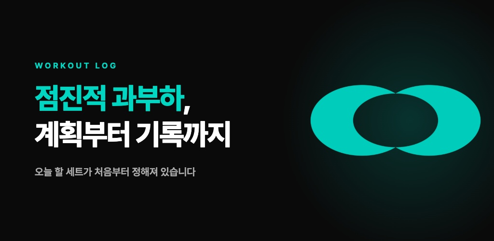
</p>

<h1 align="center">Pown · 포운</h1>

<p align="center">
  <b>P</b>rogressive <b>O</b>verload <b>W</b>orkout pla<b>N</b><br/>
  계획은 철저하게, 실행은 유연하게 — 점진적 과부하를 위한 운동 계획·기록 앱
</p>

<p align="center">
  <a href="https://apps.apple.com/us/app/pown-%ED%8F%AC%EC%9A%B4-%EC%9A%B4%EB%8F%99-%EA%B3%84%ED%9A%8D-%EA%B8%B0%EB%A1%9D-%ED%97%AC%EC%8A%A4/id6737919723"></a>
</p>

<p align="center">
  
  
  
  
  
  
  
</p>

<p align="center">
  <sub>2024.10 ~ 현재 · 1인 기획·디자인·개발·배포 · 커밋 350+ · TypeScript 2.4만 줄 + Swift 3.5천 줄</sub>
</p>

<br/>

<table>
  <tr>
    <td align="center">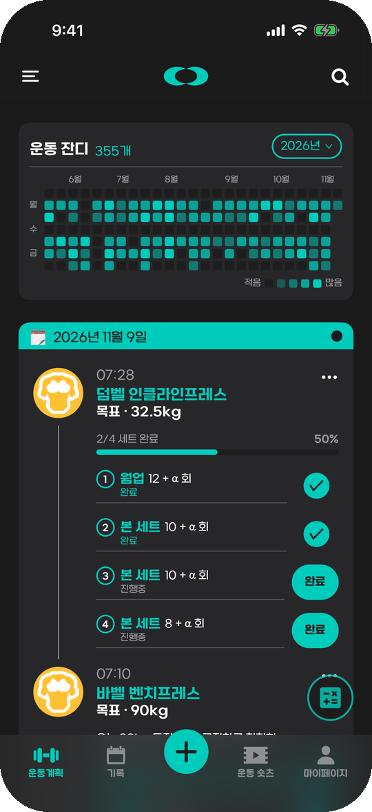</td>
    <td align="center">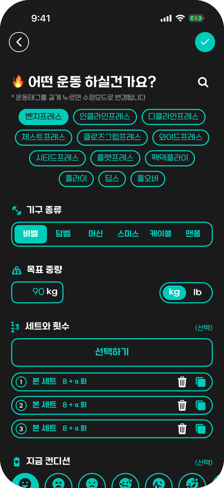</td>
    <td align="center">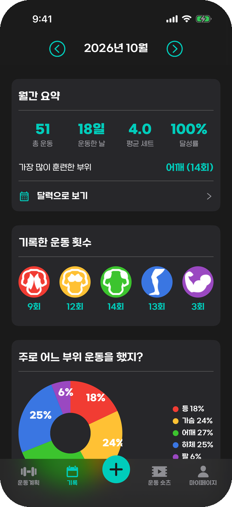</td>
    <td align="center">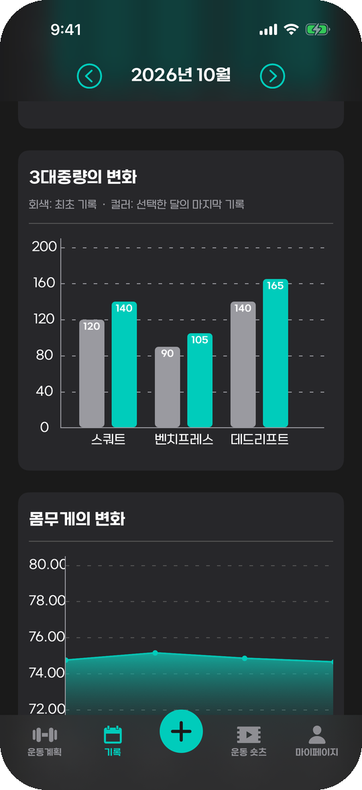</td>
  </tr>
  <tr>
    <td align="center"><sub><b>운동 탭</b><br/>운동 잔디 · 오늘의 세트 진행률</sub></td>
    <td align="center"><sub><b>계획 작성</b><br/>종목 · 기구 · 중량 · 세트 · 컨디션</sub></td>
    <td align="center"><sub><b>월간 기록</b><br/>요약 · 부위별 횟수 · 비율</sub></td>
    <td align="center"><sub><b>성장 그래프</b><br/>3대 중량 · 몸무게 변화</sub></td>
  </tr>
</table>

<sub>※ 스크린샷은 iOS 시뮬레이터에서 데모 데이터로 촬영했습니다.</sub>

## 왜 만들었나

근력은 **점진적 과부하**(지난번보다 조금 더 무겁게, 조금 더 많이)로 늘어납니다. 그러려면 지난 기록을 보고 오늘 계획을 세워야 하지만, 헬스장에선 원하는 기구가 비어 있지 않은 일이 흔합니다. 계획이 틀어지면 기록도 흐지부지되고, 동기도 같이 떨어지죠.

Pown은 **미리 세운 계획을 현장에서 유연하게 바꿔 가며 기록**하고, 쌓인 기록을 **그래프로 돌려받아** 다음 증량을 결정하도록 돕습니다. 회원가입도 서버도 없이, 모든 데이터는 기기 안에만 저장됩니다.

## 주요 기능

### 📝 계획하고, 현장에서 바꾸고, 기록한다

<table>
  <tr>
    <td align="center">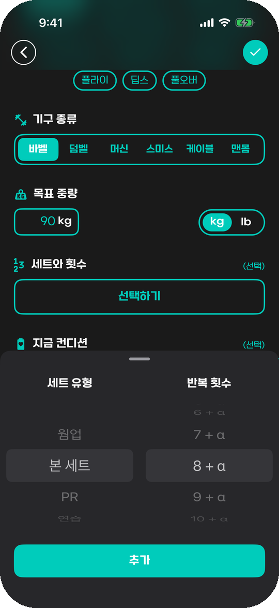</td>
    <td align="center">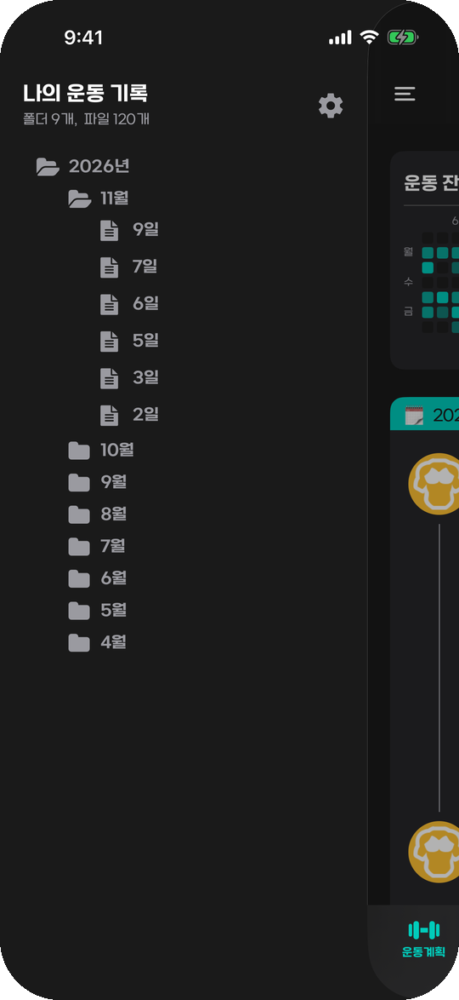</td>
    <td align="center">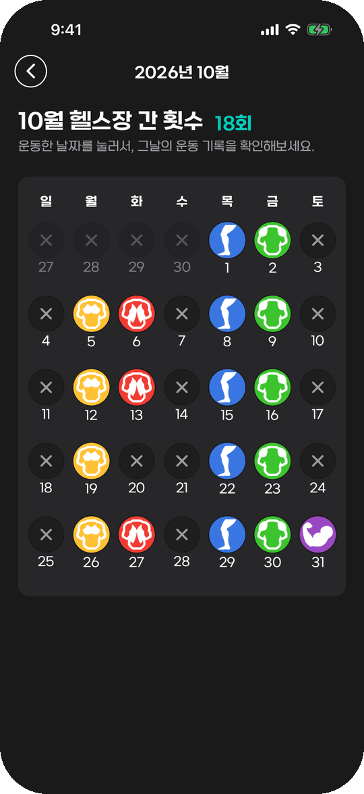</td>
    <td align="center">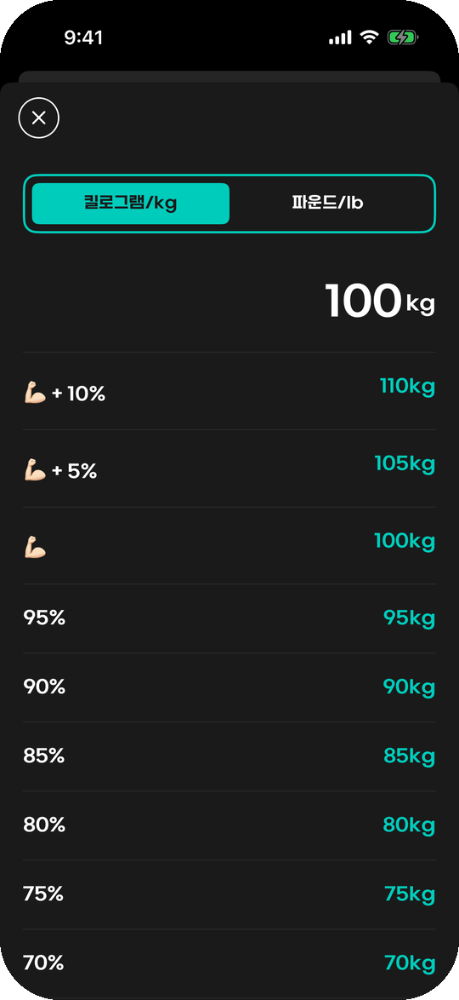</td>
  </tr>
  <tr>
    <td align="center"><sub>세트 유형·횟수 휠 선택</sub></td>
    <td align="center"><sub>연/월/일 폴더로 기록 탐색</sub></td>
    <td align="center"><sub>부위 아이콘으로 보는 한 달</sub></td>
    <td align="center"><sub>1RM 기준 % 중량 계산기</sub></td>
  </tr>
</table>

- **3초 계획 작성** — 부위를 고르면 종목 태그가 뜨고, 중량만 넣으면 끝. 세트·횟수·컨디션·메모·사진은 선택
- **세트 단위 체크** — 운동 중 세트를 하나씩 완료 처리하고 진행률을 바로 확인
- **루틴** — 여러 종목을 한 번에 계획에 추가
- **종목 태그 관리** — 내 종목 추가, 길게 눌러 드래그 정렬·삭제, **초성 검색**(`ㅂ`만 쳐도 벤치프레스)
- **노트** — 짧은 퀵 노트, 또는 서식(굵게·목록 등)이 있는 리치 텍스트 노트
- **운동 잔디** — GitHub 잔디처럼 1년간의 운동 빈도를 한눈에

### 📈 기록이 쌓이면, 성장이 보인다

- **월간 요약** — 총 운동 수, 운동한 날, 평균 세트, 달성률, 가장 많이 훈련한 부위
- **부위·기구·컨디션 통계** — 어떤 부위를, 무엇으로, 어떤 컨디션에서 운동했는지
- **3대 중량(스쿼트·벤치·데드) 변화와 몸무게 추이** — 첫 기록 대비 얼마나 늘었는지

### ❤️ 에어팟·애플워치 실시간 심박 측정 (iOS)

<table>
  <tr>
    <td align="center">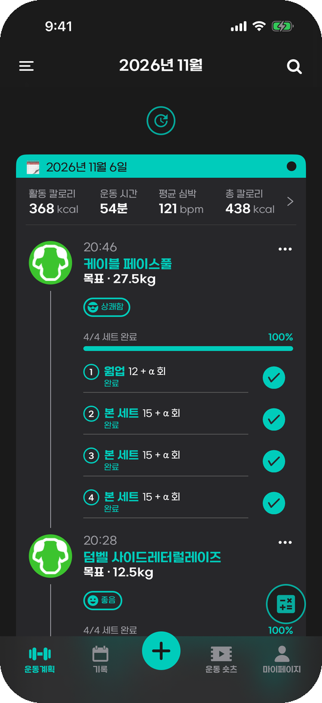</td>
    <td align="center">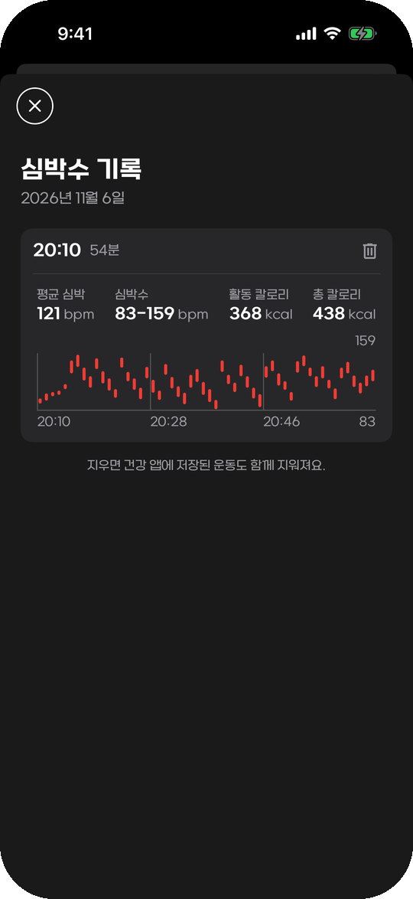</td>
    <td>
      <ul>
        <li><b>에어팟 프로 3</b>(iOS 26 iPhone 운동 세션) 또는 <b>애플워치</b>(운동 세션 미러링)로 심박·칼로리 측정</li>
        <li><b>다이나믹 아일랜드·잠금 화면 Live Activity</b>에서 일시정지·재개·종료</li>
        <li>측정 결과는 그날 운동 기록 위에 요약되고, 분 단위 심박 그래프로 다시 볼 수 있음</li>
        <li><b>휴식 알림</b> — 세트 뒤 설정한 시간만큼 쉬면 다음 세트를 알림</li>
        <li>측정한 운동은 <b>건강 앱</b>에 저장되어 활동 링에 반영</li>
      </ul>
    </td>
  </tr>
</table>

### 🎥 운동 숏츠 & AI 자세 분석

- 앱 안에서 운동 영상을 찍어 **숏츠처럼 세로로 넘겨 보며** 자세를 다시 확인
- **AI 자세 리포트** — 영상에서 종목과 반복 구간을 인식하고, 스쿼트·벤치·데드리프트 등은 실제 코칭 포인트(바 경로, 뎁스, 브레이싱 등) 기준으로 피드백

### 🎨 그 밖에

<table>
  <tr>
    <td align="center">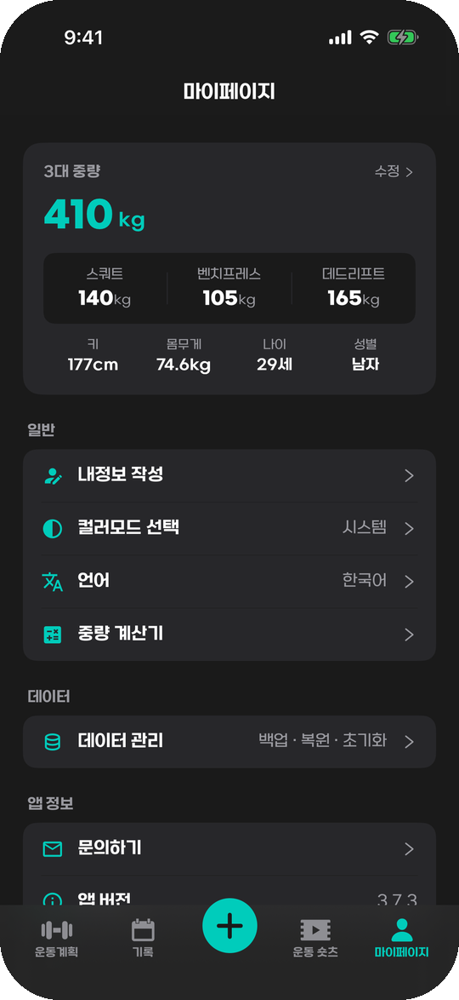</td>
    <td align="center">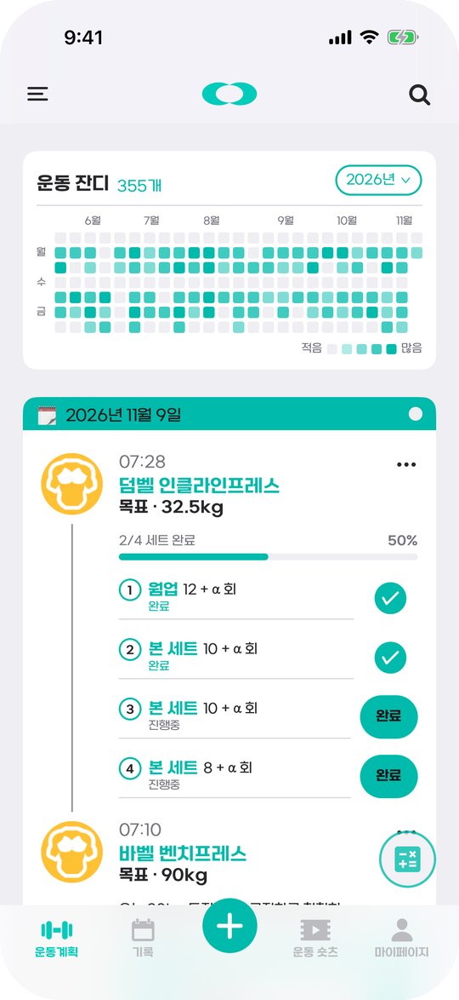</td>
    <td>
      <ul>
        <li>3대 중량·신체 정보 기록</li>
        <li>다크 / 라이트 / 시스템 테마</li>
        <li>한국어 / 영어</li>
        <li><b>백업·복원</b> — 사진·영상까지 zip 한 파일로 내보내고 다른 기기(iOS↔Android)에서 복원</li>
      </ul>
    </td>
  </tr>
</table>

## 기술 스택

| 영역 | 사용 기술 |
| --- | --- |
| 앱 | **Expo SDK 53**(dev-client, CNG) · **React Native 0.79** New Architecture · React 19 · TypeScript strict |
| 내비게이션 | Expo Router 5 (파일 기반, typed routes) — Drawer › Tabs › Stack · 모달 |
| 상태·저장 | **Zustand 5** + `persist` · **MMKV** (오프라인 우선, 백엔드 없음) |
| UI | Reanimated 3 · Gesture Handler · @gorhom/bottom-sheet · FlashList v2 · gifted-charts · react-native-svg · react-native-enriched(리치 텍스트) |
| 미디어 | expo-camera · expo-video · expo-video-thumbnails · react-native-zip-archive |
| 네이티브 (iOS) | **Swift Expo Module** — HealthKit · ActivityKit(Live Activity) · WatchConnectivity · **watchOS 컴패니언 앱** · WidgetKit (`@bacons/apple-targets`) |
| AI | Google **Gemini API** (구조화 출력, 기기에서 직접 호출) |
| 배포·운영 | **EAS Build / Submit / Update(OTA)** · AdMob 보상형 광고 · App Store 업데이트 안내 |

## 아키텍처

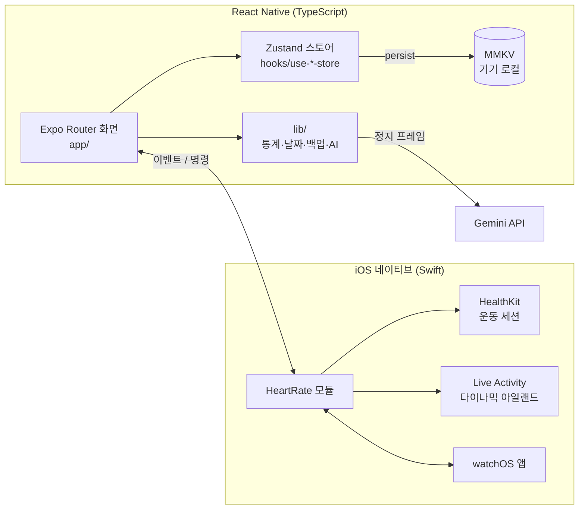

**백엔드가 없으므로 Zustand 스토어가 곧 데이터베이스**입니다. 화면은 임시 폼 스토어(`use-plan-store`)에 입력을 모으고, 저장할 때 영속 스토어(`use-workout-plan-store`)에 커밋합니다. 영속 스토어는 모두 동기식 MMKV를 거쳐 앱 시작 시 하이드레이션이 즉시 끝나고, 구버전 AsyncStorage 데이터는 처음 한 번만 읽어 옮깁니다.

## 기술적으로 고민한 것들

<details open>
<summary><b>1. AI가 "그럴듯하게 틀리지" 않게 — 2단계 호출과 enum 스키마</b></summary>
<br/>

처음엔 한 번의 호출로 종목명과 리포트를 함께 받았는데, 푸쉬업을 버피로 읽으면 리포트 전체가 틀린 종목 기준으로 쓰였고, 한국어로 답하게 하면 "사레레" 같은 헬스장 은어가 그대로 나왔습니다.

- **판별 → 리포트 2단계**로 분리: 먼저 "운동 영상인가 / 무슨 종목인가 / 어느 구간에서 드는가"를 정하고, 그 구간의 프레임만 보고 자세를 평가
- 종목을 자유 문자열이 아니라 **앱의 종목 사전(`constants/exercise.ts`)을 enum 스키마**로 강제하고, 확신이 없으면 `unknown`으로 **기권**하게 함 — 틀린 리포트가 영구 저장되는 것보다 낫다
- 영상을 통째로 올리지 않고 **정지 프레임만 샘플링**(판별 최대 20장 → 반복 구간 14장)해 무료 티어 한도와 업로드 비용을 관리
- 빅4 종목은 코치가 실제로 보는 포인트를 프롬프트에 주입 — 모델을 키우지 않고 품질을 올리는 지렛대
- 프롬프트를 고칠 때마다 감으로 판단하지 않도록 **정확도 측정 스크립트**(`scripts/ai-eval.mjs`)를 만들어, 같은 프레임 세트로 수치를 비교

</details>

<details>
<summary><b>2. React Native 앱에 Swift 네이티브 기능 붙이기 — 심박 측정</b></summary>
<br/>

- Expo Module(Swift)로 HealthKit 운동 세션을 열어 **에어팟 프로 3 / 애플워치** 심박을 받고, JS 이벤트와 Live Activity로 동시에 흘려보냄
- 백그라운드에선 JS를 거치지 않고 **네이티브가 직접 Live Activity를 갱신**, 다이나믹 아일랜드 버튼은 App Intent로 처리
- 애플워치는 운동 세션 **미러링** + WatchConnectivity, 워치 앱·위젯 타깃은 `@bacons/apple-targets`로 CNG 안에서 관리
- 기기 우선순위(이어폰 > 페어링된 워치), 이어폰을 빼면 iOS가 세션을 끝내는 경우, 앱이 꺼진 사이 끝난 측정 요약 넘겨받기 등 **실기기에서만 드러나는 경계 상황**을 하나씩 정리 ([리뷰 기록](docs/2026-10-28/README.md))

</details>

<details>
<summary><b>3. 한 코드베이스, 두 플랫폼 — 안드로이드에서도 iOS 같은 감각</b></summary>
<br/>

iOS를 먼저 출시한 뒤 안드로이드를 지원하면서, 분기문이 코드 곳곳에 퍼지지 않도록 규칙을 세웠습니다.

- 플랫폼마다 달라야 하는 것만 **`foo.ios.tsx` / `foo.android.tsx` 파일 쌍**으로 나누고(현재 20여 쌍), `Platform.OS`·`Platform.select` 분기는 **린트 에러**로 막음
- 쌍의 export 시그니처가 어긋나지 않도록 **타입 체크를 iOS 세계·Android 세계로 두 번** 실행 (`tsconfig.json` / `tsconfig.android.json`의 `moduleSuffixes`)
- iOS 휠 피커(UIPickerView)의 원통 투영·스냅·햅틱을 **안드로이드에서 JS로 재현**(`components/wheel.android.tsx`), 헤더 높이·안전영역·글꼴 줄 높이까지 iOS 실측값에 맞춤
- iOS 시뮬레이터와 안드로이드 에뮬레이터의 같은 화면을 pt/dp로 맞춰 나란히 놓고 비교 ([일치 체크리스트](docs/android-parity/README.md))

</details>

<details>
<summary><b>4. 기록이 1만 건이 되어도 — 목록 성능</b></summary>
<br/>

- 운동 기록 목록을 **FlashList v2**로 렌더링하고, 날짜 그룹 헤더와 카드를 평탄화한 행 목록으로 구성
- 세트 완료 토글 시 바뀐 계획 하나만 새 참조로 만들어 **리렌더를 최소화**
- **1만 건 더미 데이터 생성기**(`lib/seed.ts`)로 스크롤 부하를 직접 재현해 측정

</details>

<details>
<summary><b>5. 서버 없이 데이터를 지키기 — 백업·복원</b></summary>
<br/>

- 기록·설정·심박 데이터와 **사진·영상 파일까지 zip 하나로** 내보내기 → 공유 시트로 원하는 곳에 저장
- 복원 시 아카이브는 사용자가 고른 임의 파일이므로 **zip slip(경로 탈출) 방어**
- 심박 기록은 iOS 전용 기능이지만 데이터는 공통 스토어에 두어, iOS → Android → iOS로 옮겨도 기록이 유지

</details>

<details>
<summary><b>6. 라이브러리의 한계는 패치와 Config Plugin으로</b></summary>
<br/>

- `postinstall` 스크립트로 라이브러리 버그를 패치하고, **걸려야 할 패치가 안 걸리면 설치를 실패**시켜 조용한 회귀를 막음 (`scripts/patch-*.js`)
- Xcode 26(clang 21)에서 깨지는 fmt 빌드, 안드로이드 커스텀 폰트 굵기 등록 등은 **Expo Config Plugin**(`plugins/`)으로 해결해 `prebuild`가 매번 재현하도록 유지

</details>

<details>
<summary><b>7. 배포와 운영</b></summary>
<br/>

- **EAS Build → Submit**으로 스토어 배포, JS만 바뀐 릴리스는 **EAS Update(OTA)** 로 즉시 반영
- `version`과 `runtimeVersion`을 일치시켜 OTA가 호환 바이너리에만 내려가도록 관리하고, 네이티브 의존성이 바뀐 릴리스는 OTA를 금지
- 새 마이너 버전이 나오면 앱 안에서 App Store 업데이트를 안내

</details>

## 프로젝트 구조

```
app/                  Expo Router 라우트 (파일 경로 = 화면)
  (drawer)/(tabs)/    운동 · 기록 · 숏츠 · 마이페이지 탭
  (modals)/           부위 선택 · 노트 · 계산기 · 심박 기록 등 모달
components/           UI 컴포넌트 (플랫폼 차이는 *.ios.tsx / *.android.tsx 쌍)
hooks/use-*-store.tsx Zustand 스토어 (= 로컬 데이터베이스)
lib/                  통계 · 날짜 · 백업 · AI · 초성 검색 등 순수 로직
modules/heart-rate/   Swift Expo Module (HealthKit · Live Activity · Watch 연동)
targets/              watchOS 앱 · Live Activity 위젯
plugins/ · scripts/   Expo Config Plugin · 라이브러리 패치
docs/                 진단 보고서 · UI 검수 · 기능별 리뷰 기록
```

## 실행하기

```bash
npm install
npm run ios        # iOS dev-client 빌드 후 실행 (Expo Go 미지원)
npm run android    # Android dev-client 빌드 후 실행
npm run typecheck  # iOS·Android 두 세계 타입 체크
npm run lint
```

> AI 자세 분석을 쓰려면 `.env`에 `EXPO_PUBLIC_GEMINI_API_KEY`가 필요합니다.

## 개발 기록

기능을 만들 때마다 진단·검수·리뷰 결과를 [`docs/`](docs/README.md)에 남깁니다.

- [프로젝트 전수 진단 보고서](docs/2026-07-12/README.md) — 버그·UX·리팩토링·의존성 55건 진단과 수정 기록
- [배포 전 전체 UI 검수](docs/2026-07-23/README.md) — 시뮬레이터 다크·라이트 실측, 대비·정렬 이슈 전건 수정
- [리치 텍스트 에디터 도입](docs/2026-10-21/README.md) — 구조와 라이브러리 패치 목록
- [심박 측정 전체 리뷰](docs/2026-10-28/README.md) — 기록 유실 경로와 실기기 확인 목록
- [안드로이드 ↔ iOS UI 일치 체크리스트](docs/android-parity/README.md)

## 링크

- [App Store](https://apps.apple.com/us/app/pown-%ED%8F%AC%EC%9A%B4-%EC%9A%B4%EB%8F%99-%EA%B3%84%ED%9A%8D-%EA%B8%B0%EB%A1%9D-%ED%97%AC%EC%8A%A4/id6737919723)
- [개인정보처리방침](https://sites.google.com/view/pown-privacy/%ED%99%88)
